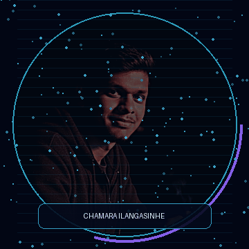

# 👋 Hey, I'm Chamara Ilangasinhe

### `Developer in progress` · `Tech enthusiast` · `Always learning`

---

## ⚡ About Me

- 🌱 Learning and building with technology.
- 💻 Interested in web development and creative projects.
- 🎯 Turning ideas into useful things, one step at a time.
- 🤝 Always open to learning and collaboration.

## 🧑‍💻 Tech Stack

## 📊 GitHub Analytics

 

## 🐍 Contribution Animation

---

### ✨ Keep learning. Keep building. Keep improving. ✨

*Thanks for visiting my profile!*

